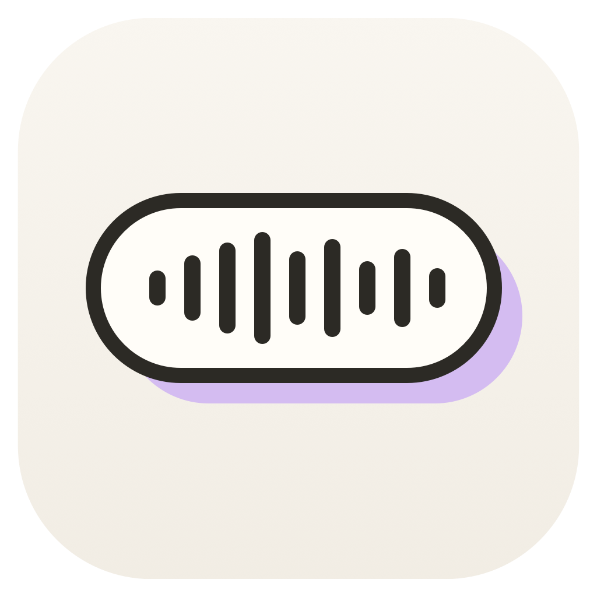
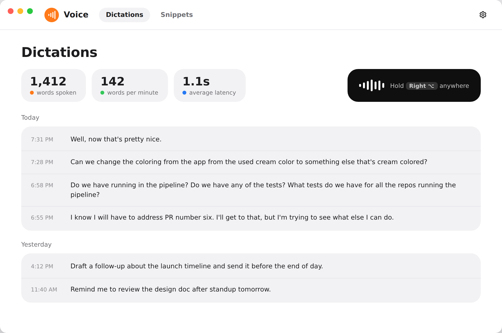
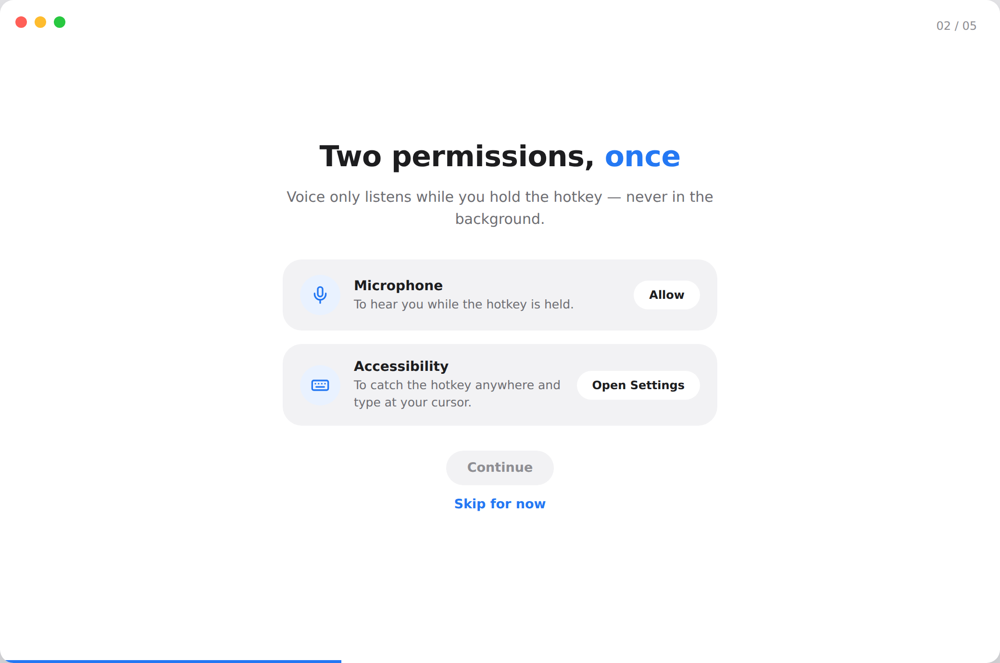
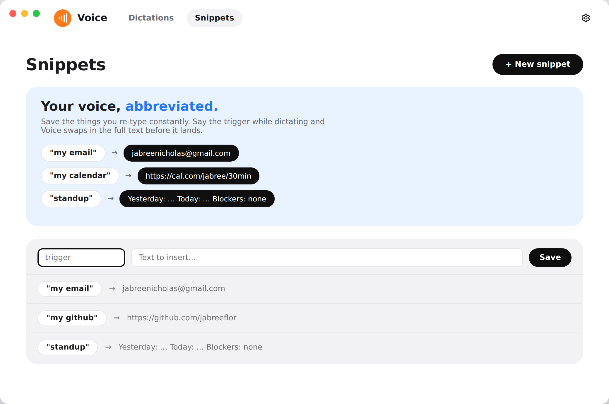
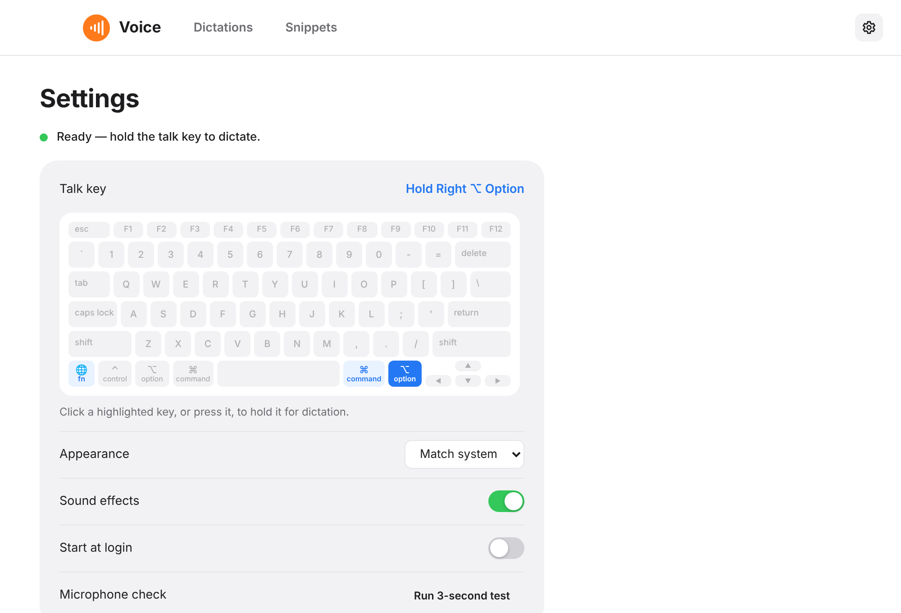
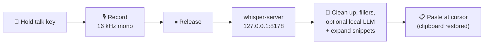

<div align="center">



# voice

**Hold a key. Speak. Release. Your words appear — in any app.**

Free, open-source, 100% local voice dictation for macOS, Windows and Linux.
A [Wispr Flow](https://wisprflow.ai) alternative with no subscription, no cloud, and no audio ever leaving your machine.

[](https://github.com/jabreeflor/voice/actions/workflows/ci.yml)


</div>

---

<div align="center">

</div>

## ⚡ Install

voice is a small tray app written in Rust ([Tauri 2](https://tauri.app)).
It needs `whisper-server` from
[whisper.cpp](https://github.com/ggml-org/whisper.cpp), which does the
actual transcription; the Mac download ships it inside the app, every other
route needs it installed separately. Pick whichever route suits you.

### Download the Mac app

Grab the latest `.dmg` from
[Releases](https://github.com/jabreeflor/voice/releases/latest):
`Voice_x.y.z_aarch64.dmg` for Apple silicon, `Voice_x.y.z_x64.dmg` for
Intel. Open it, drag **Voice** into **Applications**, launch it. The
transcription engine is bundled inside the app, so there is nothing else to
install; the speech model downloads on first launch.

The release is not notarized yet, so the first launch shows "Apple could
not verify Voice". Open **System Settings → Privacy & Security** and click
**Open Anyway**, or run
`xattr -dr com.apple.quarantine /Applications/Voice.app`.

### Prebuilt bundles from CI (Windows, Linux)

Every push to `main` builds installers on the [CI workflow](https://github.com/jabreeflor/voice/actions/workflows/ci.yml)
(`Bundle app` jobs, artifacts named `voice-<os>`; download them from the
workflow run's summary page):

| OS | Bundle | Notes |
|---|---|---|
| Windows | `Voice_x.y.z_x64-setup.exe` / `.msi` | Unsigned: SmartScreen shows "More info → Run anyway". |
| Linux | `Voice_x.y.z_amd64.deb` / `.AppImage` | `.deb` needs WebKitGTK 4.1 (`libwebkit2gtk-4.1-0`); the AppImage is self-contained. |

These do not include whisper.cpp: install it for your OS (next section),
then launch Voice.

### One-line install (macOS and Linux, builds from source)

```sh
curl -fsSL https://raw.githubusercontent.com/jabreeflor/voice/main/scripts/install.sh | bash
```

The script checks for `cargo`, `whisper-server` and (on Linux) the system
libraries, clones `main`, runs the release build, installs
`Voice.app` into `/Applications` (macOS) or the `.deb`/AppImage (Linux),
launches it, and installs `voicectl` (symlinked into a writable PATH
directory on macOS, copied into `~/.local/bin` on Linux — add that directory
to your PATH if it is not there already). Because it is built locally there
is no Gatekeeper "unidentified developer" hassle on macOS.
Windows users: use a prebuilt bundle or build from source below.

**Requirements:** [Rust](https://rustup.rs) (stable), `git`, and on macOS
the Xcode Command Line Tools (`xcode-select --install`) plus
[Homebrew](https://brew.sh). The script checks each and says what to do.

### Build from source (any OS)

```sh
cargo install tauri-cli --version "^2" --locked
git clone https://github.com/jabreeflor/voice.git && cd voice
cd crates/voice-app && cargo tauri build          # bundles land in target/release/bundle/
```

On macOS `./build.sh` does the same and additionally copies `Voice.app`
to the repo root with `voicectl` inside, then code-signs it:

```sh
./build.sh && cp -R Voice.app /Applications/ && open /Applications/Voice.app
```

Linux needs the WebKitGTK / GTK / ALSA / xdo development packages first
(Debian/Ubuntu example, the same list CI uses):

```sh
sudo apt-get install -y libwebkit2gtk-4.1-dev libgtk-3-dev libayatana-appindicator3-dev \
  librsvg2-dev libasound2-dev libxdo-dev libxtst-dev libxkbcommon-dev libssl-dev pkg-config patchelf
```

### Install whisper.cpp

Voice spawns `whisper-server` on launch and looks for it next to its own
executable, on `PATH`, and in `/opt/homebrew/bin`, `/usr/local/bin`,
`/opt/homebrew/opt/whisper-cpp/bin`, `/usr/bin`, `~/.local/bin` and
`%LOCALAPPDATA%\voice\bin`.

<details>
<summary><strong>macOS</strong></summary>

```sh
brew install whisper-cpp
```

</details>

<details>
<summary><strong>Linux</strong></summary>

Use your distribution's `whisper.cpp` package if it ships `whisper-server`,
or build it (a couple of minutes):

```sh
git clone --depth 1 --branch v1.9.4 https://github.com/ggml-org/whisper.cpp.git
cmake -S whisper.cpp -B whisper.cpp/build -DCMAKE_BUILD_TYPE=Release -DBUILD_SHARED_LIBS=OFF
cmake --build whisper.cpp/build --config Release -j
install -m 755 whisper.cpp/build/bin/whisper-server ~/.local/bin/
```

`~/.local/bin` is one of the places Voice searches, so it need not be on
`PATH`.

</details>

<details>
<summary><strong>Windows</strong></summary>

Download a `whisper-bin-x64.zip` from the
[whisper.cpp releases](https://github.com/ggml-org/whisper.cpp/releases)
(or build it with CMake) and put `whisper-server.exe` — with the DLLs that
come in the same zip — either next to `voice.exe` (the installed Voice
executable), in
`%LOCALAPPDATA%\voice\bin`, or anywhere on `PATH`.

</details>

## 🎙️ Using it

<div align="center">

</div>

On first launch a short setup assistant walks through permissions and
downloads the default speech model. What each OS needs:

| OS | Needs | Why |
|---|---|---|
| macOS | **Microphone** and **Accessibility** (System Settings → Privacy & Security) | Accessibility is what lets Voice see the talk key in other apps and type for you. Rebuilding with an ad-hoc signature drops the grant — toggle Voice off/on in the list. |
| Windows | **Microphone** (Settings → Privacy & security → Microphone, "Let desktop apps access your microphone") | The keyboard hook needs no permission. If the installer is flagged by SmartScreen, choose "Run anyway". |
| Linux | An **X11** session | The global talk key is read through XRecord. Wayland sessions are not supported yet — the Settings tab says so, and the app otherwise runs but never hears the key. Microphone access has no per-app gate. |

Then click into any text field, **hold the talk key, speak, release**. The
transcript appears at your cursor.

- <kbd>Esc</kbd> while recording cancels. (On Linux the Esc also reaches
  the focused app; on macOS and Windows it is swallowed.)
- Taps shorter than ~0.35 s are ignored, and pressing any other key while
  holding the talk key cancels and passes the key through — so your
  Option/Alt shortcuts still work.
- The tray icon shows status and turns red while recording; a small pill at
  the bottom of the screen shows the live level and "Typed: …" after a
  paste.
- On macOS Voice also checks that the paste landed: if no app took the
  text within about a second of <kbd>⌘V</kbd> (no text field focused, say),
  the pill says **"Not pasted, copied to clipboard"** and the transcript
  stays on the clipboard for you to paste by hand, instead of your old
  clipboard coming back. (A clipboard manager that reads every copy makes
  every paste look successful, so with one running you get the old
  behaviour.) Windows and Linux cannot tell, and behave as before.

### Talk key

| OS | Default | Alternatives |
|---|---|---|
| macOS | <kbd>Right ⌥</kbd> | <kbd>Right ⌘</kbd>, <kbd>fn/🌐</kbd> (set *System Settings → Keyboard → "Press 🌐 key to" → Do Nothing* so macOS doesn't also open emoji/dictation), or any other key except Esc and Caps Lock |
| Windows | <kbd>Right Alt</kbd> | <kbd>Right Ctrl</kbd>, <kbd>Right Win</kbd>, or any other key except Esc and Caps Lock |
| Linux | <kbd>Right Alt</kbd> | <kbd>Right Ctrl</kbd>, <kbd>Right Super</kbd>, the other modifiers, or an F-key |

Change it in the Settings tab, or in onboarding, by clicking a key on the
drawn keyboard (a modifier or F-key can also be picked by pressing it). A letter, digit, Space or Enter as the talk
key is swallowed while you hold it, so it will not type; on Linux only
modifiers and F-keys are offered because the X11 hook cannot swallow keys.
On a Mac, F-keys reach voice only when they act as standard function keys
(*System Settings → Keyboard → Keyboard Shortcuts → Function Keys*), or
while you also hold fn.

## 🧠 Models

On first launch voice silently downloads **base.en** (142 MB) so dictation
just works. Want more accuracy? Drop another `ggml-*.bin` from
[Hugging Face](https://huggingface.co/ggerganov/whisper.cpp/tree/main) into
`~/voice/models/` (or `~/.voice/models/`):

| Model | File | Size | Character |
|---|---|---|---|
| Tiny | `ggml-tiny.en.bin` | 75 MB | fastest |
| Base | `ggml-base.en.bin` | 142 MB | fast *(auto-installed default)* |
| Small | `ggml-small.en.bin` | 466 MB | balanced |
| Medium | `ggml-medium.en.bin` | 1.5 GB | accurate |
| Large v3 Turbo | `ggml-large-v3-turbo.bin` | 1.6 GB | best |

With several models present the app picks the fastest one that is good
enough for hold-to-talk (base → small → medium → large-v3-turbo → tiny). To
pin one, quit Voice, set `"modelFile": "ggml-small.en.bin"` in
`settings.json` (see [Where things live](#-where-things-live)), then
relaunch — the app loads `settings.json` once at startup and rewrites the
whole file whenever a setting changes, so an edit made while it is running
is lost. To force a path for one run instead:

```sh
open --env VOICE_MODEL=~/path/to/model.bin /Applications/Voice.app   # macOS
VOICE_MODEL=~/path/to/model.bin voice                                # Linux
```

(`open` launches apps through launchd, which does not inherit the shell's
environment, hence `--env`; running
`/Applications/Voice.app/Contents/MacOS/voice` directly works too.)

## ⚙️ Tray menu and window

The tray (menu-bar) icon offers **Open Voice**, **Copy Last Dictation**
(if a paste didn't land where you wanted), **Setup Assistant…** and **Quit
Voice**, with the engine status as the second line.

The main window has three tabs:

- **Dictations** — words spoken, words per minute, average latency, and a
  day-grouped ledger of everything you dictated (click a row to copy it).
- **Snippets** — say a trigger phrase, paste a longer text; below it, the
  **Vocabulary** list (see [Accuracy and cleanup](#-accuracy-and-cleanup)).
  Both are also editable from a terminal with
  [`voicectl`](#️-command-line-voicectl).
- **Settings** — permission status, talk key, appearance, the
  [accuracy and cleanup](#-accuracy-and-cleanup) switches, sound effects,
  start at login, and a 3-second microphone check.

The windows follow the system's light or dark appearance; **Settings →
Appearance** can pin either one instead (Match system / Light / Dark).

<div align="center">


</div>

## 🎯 Accuracy and cleanup

Everything here runs on your machine. Nothing below sends audio or text
anywhere but the local whisper-server.

- **Vocabulary** (Snippets tab, or `voicectl vocab`) — names and jargon
  whisper should spell your way: `Jabree`, `Tauri`, `whisper.cpp`. With
  **Settings → Use vocabulary as a hint** on (the default), every dictation
  sends your vocabulary, then your snippet triggers, to the local
  whisper-server as its `prompt`, e.g. `Jabree, Tauri, whisper.cpp, my
  email.` The line is capped at 400 characters (whisper reads at most ~223
  prompt tokens); entries that don't fit are skipped, earlier ones first in
  line. A long prompt adds a little decode time, so keep the list to the
  words whisper actually gets wrong. `voicectl vocab prompt` prints the
  exact line.
- **Remove filler words** (Settings, on by default) — drops *um*, *uh*,
  *erm* and their stretched spellings, then repairs the commas and capital
  letters around them: "Um, so I think, uh, we ship it" pastes as "So I
  think we ship it". Words that are only *sometimes* filler ("like", "you
  know", "I mean", "hmm") are left alone, and so are "umbrella", "uh-oh",
  "uh huh" and all-caps acronyms like "UM". It is plain pattern matching
  for English; turn it off if you dictate Portuguese or German, where "um"
  is a real word.
- **Polish with a local LLM** (Settings, off by default) — sends the
  cleaned transcript to an OpenAI-compatible chat endpoint **on this
  computer** to fix punctuation, casing and false starts. The default is
  [Ollama](https://ollama.com)'s `http://127.0.0.1:11434/v1/chat/completions`
  with `llama3.2:3b` (`ollama pull llama3.2:3b`); llama.cpp's
  `llama-server` and LM Studio work too. Only `127.0.0.1`, `::1` and
  `localhost` URLs are accepted — anything else is refused before a
  connection is made, and the request ignores proxy settings — so the
  text cannot leave the machine. The pass gives up after 2.5 s, and on any
  error (server not running, model missing, a reply that looks like the
  model answered instead of cleaning) the un-polished text is pasted, so
  dictation never blocks on it. Snippets are expanded after the pass, so
  their text is pasted exactly as written.

## ⌨️ Command line: `voicectl`

`voicectl` ships next to the app (inside `Voice.app` on macOS) and the
installer links it onto your PATH. It edits the same snippets and
vocabulary the app uses, so scripts and coding agents can manage them without clicking
through the Snippets tab. The running app picks changes up immediately.

```sh
voicectl snippets add "my email" "you@example.com"   # say "my email" to paste it
voicectl snippets add signoff - <<'TXT'              # multi-line text from stdin
Best,
Jabree
TXT
voicectl snippets list                               # or --json
voicectl snippets expand "okay brb see you"          # preview the rewrite
voicectl snippets remove brb
voicectl snippets export > snippets.json             # back up / share
voicectl snippets import snippets.json               # merge (--replace to overwrite)
voicectl snippets path                               # where snippets.json lives

voicectl vocab add Jabree Tauri whisper.cpp          # words whisper should spell your way
voicectl vocab list                                  # or --json
voicectl vocab remove Tauri
voicectl vocab prompt                                # the prompt whisper gets
voicectl vocab export > vocabulary.json              # import works like snippets
```

Exit status is 0 on success, 1 when a trigger is missing or input is
invalid, and 2 for a usage error. `--dir <path>` targets another data
directory. If the installer could not find a writable bin directory, link
it yourself:

```sh
sudo ln -sfn /Applications/Voice.app/Contents/MacOS/voicectl /usr/local/bin/voicectl   # macOS
```

On Windows and for source builds, `cargo build --release -p voicectl`
produces `target/release/voicectl[.exe]`.

## 📁 Where things live

| | macOS | Windows | Linux |
|---|---|---|---|
| Settings, history, snippets, vocabulary | `~/Library/Application Support/Voice/` | `%APPDATA%\Voice\` | `~/.local/share/Voice/` |
| Models | `~/voice/models/` (or `~/.voice/models/`) | `%USERPROFILE%\voice\models\` | `~/voice/models/` |

History and snippets are the same `history.json` / `snippets.json` the
original macOS app wrote, so an existing library carries over.

## 🔬 How it works



- On launch the app spawns `whisper-server` on `127.0.0.1:8178`, so the
  model stays loaded in memory — a typical utterance transcribes in well
  under a second on Apple Silicon.
- A global keyboard hook (CGEvent tap on macOS, low-level hook on Windows,
  XRecord on Linux) watches the talk key; audio is captured with `cpal`
  and resampled to 16 kHz mono.
- On release, the WAV is POSTed to the local server (with your vocabulary
  as whisper's prompt), the transcript is cleaned of whisper's non-speech
  markers and filler words (and optionally polished by a local LLM), snippet triggers are expanded,
  the text is placed on the clipboard, and <kbd>⌘V</kbd> / <kbd>Ctrl+V</kbd>
  is synthesized into the frontmost app — your previous clipboard is
  restored afterwards. On macOS the text is put on the clipboard as a
  *promise* that is only filled in when an app reads it, which is how
  Voice knows whether the paste was taken.

**Privacy:** the server binds to localhost only. No telemetry, no accounts,
no network calls except model downloads from Hugging Face. The optional
LLM polish talks only to a loopback address you run yourself.

## 🛠️ Development

The workspace has three crates: `voice-core` (pure logic, builds and tests
on every OS), `voicectl` (the CLI) and `voice-app` (the Tauri desktop app).

```sh
cargo build --workspace                                # compile everything
cargo test --workspace                                 # unit + integration tests
cargo clippy --workspace --all-targets -- -D warnings  # CI lint
cargo fmt --all --check                                # CI formatting
cargo test -p voice-core                               # just the pure core (fast)

cargo install tauri-cli --version "^2" --locked
cd crates/voice-app
cargo tauri dev                                        # run the app with logging
cargo tauri build                                      # installers → target/release/bundle/
```

- The integration tests (`crates/voice-core/tests/engine_integration.rs`)
  boot a real `whisper-server` on port **18178** — never the app's 8178 —
  with a ggml model from `~/voice/models`. When either is missing they
  print `SKIPPED: <reason>` and pass; CI installs both and fails if that
  line appears.
- `VOICE_ENGINE_LOG=1` lets `whisper-server`'s own output through to the
  terminal (CI sets it) so a wrong transcription can be traced.
- The UI is static HTML/CSS/JS in `crates/voice-app/ui`; `assets/app-prototype.html`
  is the design reference for its tokens.
- macOS-only code is behind `#[cfg(target_os = "macos")]` and is compiled by
  the macOS CI job. From Linux you can still cross-check Windows with
  `cargo check -p voice-app --target x86_64-pc-windows-gnu`.

On macOS, rebuilding re-signs the binary, so the system will ask you to
re-grant **Accessibility** (toggle Voice off/on in the list). Microphone
permission survives. Signing with a real identity in your keychain
(`build.sh` picks it up automatically) avoids this.

### Cutting a release

Bump `version` in `crates/voice-app/tauri.conf.json`, merge, then push a
matching tag (`git tag v2.0.1 && git push origin v2.0.1`). The
[Release workflow](.github/workflows/release.yml) builds whisper-server
from source, bundles it into `Voice.app`, and attaches the Apple silicon and
Intel `.dmg` files to a GitHub Release. Running the workflow by hand builds
the same `.dmg` files as artifacts without publishing. With the
`APPLE_CERTIFICATE`, `APPLE_CERTIFICATE_PASSWORD`, `APPLE_SIGNING_IDENTITY`
(and, for notarization, `APPLE_ID`, `APPLE_PASSWORD`, `APPLE_TEAM_ID`)
repository secrets set, the app is signed with your Developer ID and
notarized; without them it is ad-hoc signed.

See [`AGENTS.md`](AGENTS.md) for the layout, invariants and conventions.
